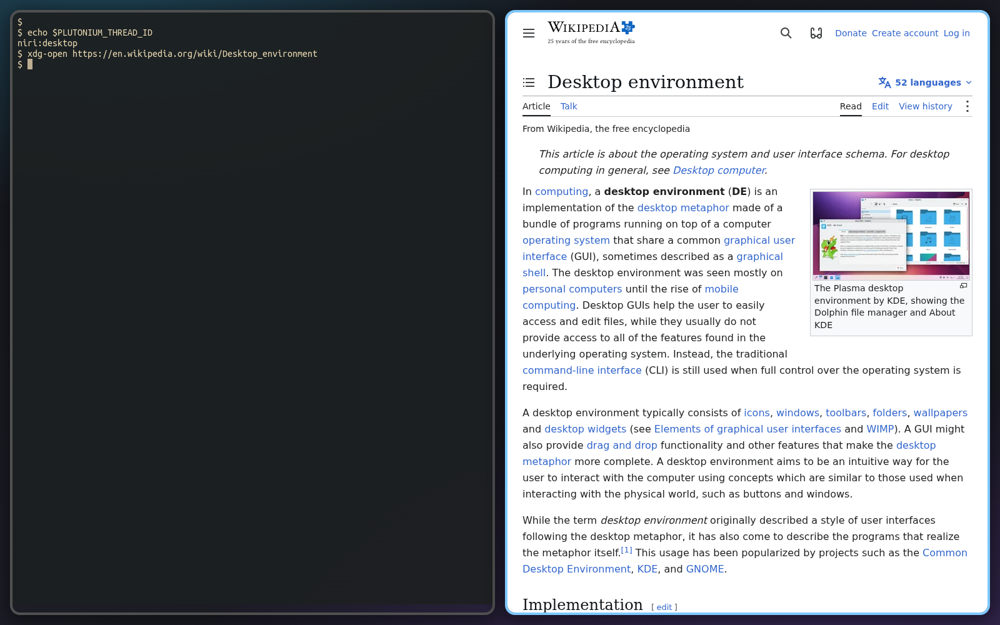

# Plutonium

A web-based desktop environment for Linux.

In Plutonium, the desktop is a web page. Native apps (Wayland and X11) and real browser tabs are elements in that page, which you can lay out, style and script like any other part of the page. So a window manager, a launcher or a whole desktop shell is just a web app.



- **Bring your own shell.** It comes with four: [Styx](docs/features/STYX_SHELL.md) (scrollable tiling, after [niri](https://github.com/YaLTeR/niri)'s design), [Charon](docs/features/CHARON_SHELL.md) (floating windows, workspaces as threads, after GNOME Shell's design), a minimal reference shell, and [Hydra](shells/hydra/README.md) (coding agents, built on [T3 Code](https://github.com/pingdotgg/t3code)). You can run several at once and switch between them with Super+Tab.
- **Apps and tabs side by side.** Apps get the GPU, keyboard, mouse, touchpad, fullscreen, pointer lock, and drag and drop. Tabs are real Chromium tabs.
- **Work stays together.** Every app and tab belongs to the thread or workspace that started it. A link clicked in a terminal opens as a tab next to it, and a file opens in its app in the same place.
- **Built for agents.** An agent can see, launch, screenshot and drive its own thread's apps and tabs over MCP.

Plutonium is built on Chromium's ChromeOS desktop (Ash) and its Wayland server (Exo). It runs directly on the display hardware, like any Wayland compositor, or in a window on your current desktop.

## Status

A public beta: usable day to day by its developer, new to everyone else. Working: several monitors, the clipboard between apps and pages, screen sharing and screenshots (the desktop portal, grim), the file picker and printing for native apps, input methods (text-input-v3), global shortcuts, H.264 video in tabs, and a login screen entry. Shells are installed packages in `~/.pluto/shells`, which you or an agent edit safely ([SHELL_PACKAGES.md](docs/features/SHELL_PACKAGES.md)). Not there yet:
- a settings page to choose an input method;
- the other desktop portals (notifications, settings, OpenURI).

**Supported:** x86-64 Linux with systemd and glibc 2.35 or newer, and an AMD or Intel GPU on Mesa (a checkout also needs rootless podman). It's developed on NixOS with AMD graphics, and has run on real hardware with Debian and Fedora too. Ubuntu 24.04 is tested as far as a container allows; Intel should work, and NVIDIA is untested. See [docs/BACKLOG.md](docs/BACKLOG.md).

## Quick start

The release is one package, with no podman or checkout. [INSTALL.md](INSTALL.md) says what it needs and explains each step.

1. Install it. The installer puts it in `/opt/plutonium` and adds Plutonium to your login screen, and says if anything is missing. On NixOS, it ends with the module to add to your configuration (INSTALL.md).

   ```sh
   curl -fsSL https://elsargo.github.io/pluto/install.sh | sh     # or: sh install.sh --from plutonium-<version>-x86_64.tar.xz
   plutonium doctor                          # what's missing, and the command that fixes each
   ```

2. Try it in a window on your current desktop:

   ```sh
   plutonium run --x11 :0 niri   # Styx; plutonium stop --x11 ends it
   ```

3. To run it as your whole desktop, log out and pick Plutonium at the login screen. Or switch to a text console (Ctrl+Alt+F2), log in, and run `plutonium run`.

In Styx, Super+T opens a terminal, Super+D the launcher, and Super+Shift+/ lists every key. Super+Tab switches shells. Ctrl+Alt+Backspace ends the session.

The first run installs the shells in `~/.pluto/shells`. From then on, `plutonium run` with no shells runs the ones you left on in the switcher. To change a shell, pick it in the switcher (Super+Tab) and choose **Copy a prompt for your agent** (paste it into whatever agent you use) or **Open a terminal**. **New shell…** under Add a shell makes your own. A change that breaks it is rolled back. `plutonium run --safe` always gets you the plain shell.

**If it hangs,** `plutonium stop --drm` over ssh ends it, and the text console comes back. **Logs** are in `~/.local/share/plutonium/logs` (a checkout: `logs/`). To **report a bug**, open an issue with what `plutonium doctor` says and those logs (INSTALL.md, "Reporting a bug"). `sh install.sh --uninstall` removes Plutonium; your data stays.

## Developing

To work on Plutonium itself, run it from a checkout, with Plutonium's Chromium [built from source](docs/BUILDING.md) in a podman container. [INSTALL.md](INSTALL.md) walks through it (podman, Node.js 24, `plutonium container create`, `plutonium chromium build`), and [docs/DEVELOPING.md](docs/DEVELOPING.md) covers testing, worktrees, and making a release.

## Repository

| Path | |
|---|---|
| `bin/plutonium`, `lib/` | The command for sessions and setup (`plutonium help`): what a release install has |
| `chromium/` | The Chromium revision, patches and build settings ([README](chromium/README.md)) |
| `helper/` | `plutoniumd`: threads, app launching, links, the agent bridge ([README](helper/README.md)) |
| `shells/` | The shells Plutonium ships (installed into `~/.pluto/shells`) |
| `skill/` | The skill agents read to work on your desktop (written to `~/.pluto/SKILL.md`) |
| `shells/hydra/` | Hydra, all of it: its launcher (`plutonium hydra`), and in `src/` the patches that turn T3 Code into it ([README](shells/hydra/README.md)) |
| `dev/` | A checkout's own commands and files, which a release install doesn't have: Chromium builds, the container (`dev/container/`), `HOST=1`'s Nix build (`dev/nix/`), worktrees, and the release bundle (`dev/bundle/`, [DEVELOPING.md](docs/DEVELOPING.md#the-release-bundle)) |
| `tools/` | Test tools |
| `docs/` | [Using](docs/USING.md), [building](docs/BUILDING.md), [architecture](docs/ARCHITECTURE.md), [developing](docs/DEVELOPING.md), per-feature docs |

## License

MIT. See [LICENSE](LICENSE). The Chromium patches are under Chromium's BSD-style license.
